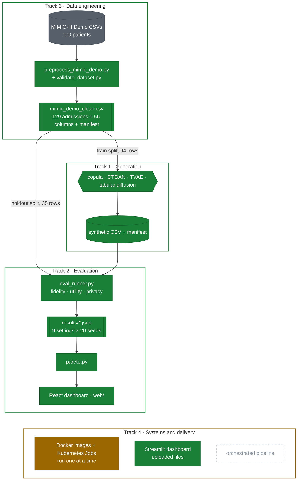

# Project Doppel

**A distributed pipeline for benchmarking synthetic EHR generators on fidelity, utility, and privacy — under one dataset, one protocol, one environment.**

**See the results live: [doppel-six.vercel.app](https://doppel-six.vercel.app/)** — every generator compared on all three measures, the trade-off chart, and an upload tool that checks your own synthetic file in the browser.


[](https://doppel-six.vercel.app/)


---

## What this is

Doppel trains families of synthetic Electronic Health Record generators on the MIMIC-III Clinical Database Demo — a statistical baseline (Gaussian copula), a GAN-family and a VAE model (CTGAN, TVAE), and a tabular diffusion model — and scores every one on the same fidelity, downstream-utility and privacy-attack protocol, so results are comparable instead of being separate numbers from separate papers. Nine configurations across the three families, including a no-dependence floor, have been evaluated over 20 seeds each (180 runs; [`docs/final_evaluation_result.md`](docs/final_evaluation_result.md)). **The headline is a trade-off, not a winner: the diffusion model fits the data best of any neural generator and leaks most, identifying 36% of training patients at a 1% false-positive rate, while the tuned copula is the only arm that is both faithful and non-copying. The attacks are validated against a generator known to memorize, and a weak 4-column attack rates that same generator the safest of all (0.499), which is why the privacy score is the worst of three attacks.**

> **Status (2026-10-21):** Week 5 of a 14-week plan that started 2026-09-17, and ahead of it: most Phase 3 deliverables are in and Phase 4 report writing has started. All three generator families exist and are tuned (Track 1). Track 2 has evaluated all nine arms, including the four added in Phase 3 (two diffusion configs, a tuned copula, a tuned CTGAN), and written the report's Evaluation section. Track 4 has generation and evaluation Jobs on shared storage, launched one at a time rather than as an orchestrated pipeline.

---

## Architecture



**Green** components exist and have been run by their owners. **Amber** exists and runs, but only partly: the Docker images and Kubernetes Jobs are launched one at a time by hand, and the Jobs do not yet use the tuned settings. **Grey and dashed** does not exist yet: the automated pipeline that runs every stage on a cluster without manual steps. The data path from raw CSVs to the Pareto frontier works end to end as separate scripts.

---

## The problem

Hospitals want to share patient data for research without violating privacy, and synthetic data generation is the usual answer — but published evaluations of synthetic EHR generators are inconsistent: different studies use different attack models and different downstream tasks, so results can't be compared across papers. The problem shows up concretely at this project's scale. With 94 training rows and 110 modeled columns, the most flexible generator tried (TVAE) copies 52 to 71% of its rows in Track 1's sweep, and the dataset's own patient-level split leaves one ethnicity group (15 of 35 holdout admissions) absent from train entirely. Doppel fixes one dataset, one protocol, and one environment so the generator families are graded on identical, reproducible terms.

---

## How it works

| Layer | What it does |
|---|---|
| Data Prep (Track 3) | Loads 7 MIMIC-III Demo tables, builds one row per hospital admission (demographics, labs, ICD-9 codes, LOS), splits 80/20 by patient to avoid leakage, and writes a single clean CSV plus two lookup tables. |
| Generation (Track 1) | Encodes the `train` split into one shared 110-column modeling frame (ICD-9 codes as multi-hot plus a rare-code tail), fits a generator on it, and decodes the samples back to the exact schema of the cleaned CSV. Every output is checked against a written contract before it's saved. All three families are built (Gaussian copula, CTGAN/TVAE, tabular diffusion), and hyperparameters are chosen inside train with a memorization check (DCR), never on the holdout. |
| Evaluation (Track 2) | Scores any dataset matching that schema on fidelity (JS divergence, correlation preservation, KS tests), downstream utility (train-on-synthetic/test-on-real AUROC), and privacy (shadow-model membership inference, attribute inference). |
| Aggregation (Track 4) | Docker images per stage, Kubernetes generation and evaluation Jobs sharing a persistent volume, and a Streamlit dashboard. The dashboard takes uploaded datasets and evaluation reports, scores a synthetic file against the real one, and renders the fidelity–utility–privacy comparison and Pareto frontier. |

---

## Results

### 1. Clean, validated, leakage-safe dataset (Track 3)

| Stage | Value |
|---|---|
| Source | MIMIC-III Clinical Database Demo v1.4, 100 patients |
| Output rows / columns | 129 hospital admissions / 56 columns |
| Train / holdout split | 94 / 35 admissions, split by `subject_id` (patient-level, not admission-level) |
| Random seed | 42 |
| `python preprocessing/validate_dataset.py` | `VALIDATION PASSED`, 129 rows, 56 columns, all checks green (run 2026-09-24) |

> **Honest scope:** this is real data, cleaned. The patient-level split is leakage-safe but, on 100 patients, leaves `HISPANIC/LATINO - PUERTO RICAN` at 15 of 35 holdout rows and 0 of 94 train rows, which invalidated the original ethnicity attribute attack. The validator catches 7 of 7 faults it was designed for but cannot see this kind of gap (P-018). See [`schema_and_feature_dictionary.md`](docs/schema_and_feature_dictionary.md) for the known-issues list and [`docs/dataset_validation_result.md`](docs/dataset_validation_result.md) for the evidence.

### 2. Generators and in-train model selection (Track 1)

165 fits (11 configs × 3 seeds × 5 patient folds). Each generator fits on 4/5 of train and is checked for copying against the unseen fifth. The holdout is never read.

| Generator (best or least-bad config) | DCR ratio (1 = as novel as real) | Near-copy rate (~0.05 = none) | Mean JSD | Corr. diff |
|---|---|---|---|---|
| `independent_marginals` (floor) | 1.099 | 0.005 | 0.020 | 0.175 |
| `gaussian_copula`, λ = 0.25 | 1.037 | 0.021 | 0.020 | **0.119** |
| `ctgan`, 300 epochs | 1.175 | 0.001 | 0.103 | 0.177 |
| `tvae`, 300 epochs | **0.719** | **0.519** | 0.117 | 0.134 |

> **Honest scope:** these are in-sample selection numbers, not the holdout benchmark. At 94 training rows the copula leads, CTGAN copies nothing but underfits below the independent floor, and TVAE collapses onto a subset of patients. A second sweep then tested smaller networks and stronger regularization and did not change either verdict, see Result 7. Writeup and failure-mode checks: [`docs/sweep_result.md`](docs/sweep_result.md).

### 3. Final evaluation, nine arms × 20 seeds (180 runs)

All three generator families and the tuned configurations, every run in one environment. Fidelity is against real train; utility is train-on-synthetic, test on the 35-row holdout (`hospital_expire_flag`); mean over 20 seeds. Real-data reference for utility: TRTR AUROC 0.737 (random forest).

| Arm | Mean JSD | Corr. diff | TSTR AUROC (RF) | Worst-case membership AUROC | Gower TPR at 1% FPR (chance 0.01) |
|---|---|---|---|---|---|
| `independent_marginals` | 0.0162 | 0.1629 | 0.480 | 0.638 | 0.014 |
| `gaussian_copula` | 0.0165 | 0.1376 | 0.599 | 0.645 | 0.019 |
| `gaussian_copula_shrink025` | 0.0165 | 0.1098 | 0.684 | 0.651 | 0.038 |
| **`gaussian_copula_shrink010`** | 0.0161 | **0.1020** | 0.711 | 0.656 | 0.043 |
| `ctgan` | 0.0937 | 0.1653 | 0.546 | 0.637 | 0.013 |
| `ctgan_small` | 0.0724 | 0.1690 | 0.536 | **0.632** | 0.010 |
| `tvae` | 0.1063 | 0.1224 | 0.738 | 0.680 | 0.058 |
| `tabular_diffusion` | 0.0422 | 0.1743 | **0.810** | **0.787** | **0.358** |
| `tabular_diffusion_reg` | **0.3778** | 0.1603 | 0.793 | 0.706 | 0.208 |

> **Honest scope:** the two highest utility scores belong to arms that should not be trusted on that axis. `tabular_diffusion` reaches 0.809 while reproducing most of its training rows, and `tabular_diffusion_reg` reaches 0.793 while generating 81% in-hospital deaths against 36% in the real data, which AUROC tolerates because it only ranks patients. CTGAN's correlation sits above the no-dependence floor at both network sizes, so it learned no relationships between columns. The membership-attack floor on this dataset is about 0.64 rather than 0.50, since even the no-dependence arm scores 0.640. Seeds resample generators and not patients, and every p-value is uncorrected. Full table and tests: [`docs/final_evaluation_result.md`](docs/final_evaluation_result.md) (Track 2). Track 1 ran the same nine arms independently and the two agree within rounding, with the mortality check and the frontier sensitivity in [`docs/final_comparison_result.md`](docs/final_comparison_result.md).
>
> **Holdout robustness:** one patient holds 15 of the 35 holdout rows. Rerunning every arm without them (`--clean-holdout`) moves utility up by 0.08 to 0.10 for every arm and leaves the ordering intact, so these numbers stand. Attribute inference was genuinely distorted by that patient and is reported from the clean holdout instead (ADR-032).

### 4. Privacy attacks validated against a memorizing generator (Track 2)

Shadow-model AUROC over 8 shadow generators, 20 seeds. The ceiling is a generator that returns its training rows, and the floor returns real rows it never saw.

| Arm | 4 numeric columns | Gower, all columns | ICD-9 code sets | Gower TPR at 1% FPR |
|---|---|---|---|---|
| Ceiling (exact copy) | 1.000 | 1.000 | 1.000 | 1.000 |
| Floor (unseen real rows) | 0.502 | 0.503 | 0.489 | 0.009 |
| `gaussian_copula` | 0.515 | 0.585 | 0.646 | 0.020 |
| `gaussian_copula_shrink010` | 0.524 | 0.628 | 0.656 | 0.042 |
| `ctgan_small` | 0.507 | 0.542 | 0.635 | 0.011 |
| `tvae` | 0.499 | 0.649 | 0.681 | 0.051 |
| `tabular_diffusion_reg` | 0.506 | 0.704 | 0.689 | 0.208 |
| `tabular_diffusion` | **0.574** | **0.787** | **0.738** | **0.360** |

> **Honest scope:** the diffusion model is the clearest leak in the project, and the rate at a strict threshold says it better than the AUROC does: at a 1% false-positive rate the attack identifies **36% of training members**, against 0.9% for real rows the generator never saw. It is also the only arm the weak 4-column attack catches (0.574), because it copies whole rows rather than leaking through codes alone. Codes seen only once in train leak through every generator (AUROC 0.82 to 0.84 against a 0.48 floor, including CTGAN), so that channel belongs to any generator that emits codes it saw. A direct attack on the generator fit on all 94 rows has no valid non-members and can't confirm these numbers. An AUROC near 0.5 means these attacks found nothing, not that the data is safe. See [`docs/positive_control_result.md`](docs/positive_control_result.md) and the [literature survey](docs/membership_inference_survey.md).

### 5. Pareto frontier over fidelity, utility and privacy (Track 2)

Eight of the nine arms are on the frontier and only TVAE is dominated, so the frontier shows trade-off directions rather than a ranking. The sensitivity analysis is the informative part: drop the utility axis and both diffusion arms fall from about 0.98 to **0.00**, because their frontier place rests entirely on the axis distorted by copying and by a wrong mortality rate. Add a correlation axis instead and the tuned copula is on the frontier in **every** bootstrap sample. See [`docs/final_comparison_result.md`](docs/final_comparison_result.md) and [`docs/full_pareto_result.md`](docs/full_pareto_result.md).

### 6. Systems layer (Track 4)

| Component | What exists in the repository | Status |
|---|---|---|
| Docker images | `base`, `preprocessing`, `statistical`, `ctgan`, `diffusion`, `evaluation` (plus a neural variant), `dashboard`, `smoke-test` | One image per stage, all three generator families covered |
| Kubernetes | Namespace `doppel`, a shared `doppel-shared-pvc`, generation Jobs for the statistical, CTGAN and diffusion arms, two evaluation Jobs, preprocessing, a data-loader pod, and the dashboard Deployment and Service | All twelve manifests parse. Generation and evaluation were validated on Minikube for the copula and CTGAN at seed 42 |
| Job configuration | Each generation Job runs the configuration the tuning selected (ADR-029), and the four heavy Jobs set CPU and memory requests and limits | Fixed in Phase 4; the CTGAN Job previously ran `epochs=1`, a smoke value |
| Contracts | `generator_output`, `dataset` and `evaluation_result` JSON schemas | `generator_output` is strict and every manifest validates; `evaluation_result` is loose, with free-form `fidelity`, `utility` and `privacy` objects |
| Dashboards | A Streamlit app that scores uploaded files, and a React site published from `web/` | Both take uploads and neither reads the pipeline's directories |

> **Honest scope:** stages are still launched one Job at a time, so an end-to-end run is manual. Kubernetes preprocessing exists but is not wired into a sequence, and nothing retries or orders the stages. The images and Jobs in this section were last built and run on Minikube by Track 4; the Phase 4 configuration changes above were validated by parsing every manifest and by running the same commands outside Kubernetes, not by a cluster run. See [`docs/D2_system_integration.md`](docs/D2_system_integration.md) and [`docs/track4_phase3_runbook.md`](docs/track4_phase3_runbook.md).

### 7. Diffusion generator and final tuning (Track 1): no neural arm works at n = 94

The third family now exists, and 390 fits across two grids tuned every arm. Best setting per family, selected inside train:

| Arm | DCR ratio | Near-copy rate | Mean JSD | Corr. diff | Verdict |
|---|---|---|---|---|---|
| `gaussian_copula`, λ = 0.10 | 1.025 | 0.035 | 0.020 | **0.111** | faithful, doesn't copy |
| `ctgan`, 300 epochs, 64×64 | 1.139 | 0.002 | 0.076 | 0.182 | doesn't copy, learns no dependence |
| `tvae`, 300 epochs, l2scale 1e-3 | 0.716 | 0.543 | 0.117 | 0.134 | memorizes at every setting tested |
| `tabular_diffusion`, 3000 steps | 0.532 | 0.804 | **0.036** | 0.156 | best neural fidelity, copies 80% of rows |
| `tabular_diffusion`, 1000 steps + dropout 0.2 | 1.159 | 0.084 | 0.374 | 0.168 | stops copying, loses the fidelity |

> **Honest scope:** still in-sample selection numbers, not the holdout benchmark. Tuning did not rescue either neural family: shrinking CTGAN improved its marginals by a quarter and left correlation at the no-dependence floor, TVAE got worse with less training, and across 14 diffusion settings every config that stopped copying scored worse marginals than independent sampling. This is a small-data result, not a verdict on these architectures: 94 rows against 110 modeled columns is far outside their intended regime. Full writeup: [`docs/phase3_tuning_result.md`](docs/phase3_tuning_result.md).

---

## Honest limitations

- **No neural generator works at this sample size.** All three families exist and are tuned, but on 94 training rows CTGAN learns no dependence between columns, and TVAE and the diffusion model reproduce their training rows. The classical baseline is the only arm that is both faithful and non-copying.
- **The modeling frame is wider than the data.** 110 modeled columns against 94 training rows (d > n) means any flexible generator can memorize the training set.
- **Orchestration is partly manual.** Docker images, Kubernetes Jobs for generation and evaluation, shared storage and the dashboards exist and run on Minikube, and the Jobs now run the selected configurations, but each Job is launched by hand and Kubernetes preprocessing isn't wired into a sequence.
- **The demo dataset is small and skewed.** 100 patients, and one of them holds 15 of the 35 holdout rows, which produces the ethnicity gap (that patient is the entire Puerto Rican group) and a 12 F / 23 M holdout. `generators.schema.clean_holdout()` removes them, utility is robust to it, and attribute inference is reported without them (ADR-032).
- **6 lab-value cells are null** across 3 lab columns (Calcium, Magnesium, Phosphate); the utility pipeline median-imputes them, but that choice hasn't been validated against alternatives.
- **No automated test suite.** Validation is manual script runs plus built-in checks: the contract validator, the calibration controls, and a 27-file parity test between the Python and browser contract checks, not `pytest` coverage.
- **No CI/CD.** Nothing runs automatically on push.
- **This is a course project** (Big Data Analysis) on a 14-week plan started 2026-09-17 — scope and deadlines may still shift.

---

## Repository structure

```
.
├── evaluation/                       # Track 2: fidelity, utility and privacy evaluation
│   ├── arms.py                       #   named generator configurations that are evaluated
│   ├── fidelity_metrics.py           #   JS divergence, correlation preservation, KS tests
│   ├── utility_eval.py               #   train-on-synthetic / test-on-real utility pipeline
│   ├── membership_inference.py       #   shadow-model membership attacks (numeric, Gower, ICD-9 codes)
│   ├── attribute_inference.py        #   attribute-inference attack, reported as a member gap
│   ├── eval_runner.py                #   scores one arm and seed, writes contract JSON to results/
│   ├── summarize_results.py          #   mean +/- sd per arm over seeds
│   ├── pareto.py                     #   Pareto frontier with sensitivity and dominance probabilities
│   ├── mia_calibration.py            #   ceiling, floor and positive-control calibration of the attacks
│   ├── mia_direct_check.py           #   direct attack on the synthetic files, with intervals
│   ├── mia_count_check.py            #   tests a neighbourhood-count attack feature (adds nothing)
│   └── synthetic_coverage.py         #   how many train rows each generator's output sits nearest to
├── generators/                       # Track 1: generators, shared codec, contract, model selection
│   ├── base.py, schema.py            #   generator interface and dataset schema constants
│   ├── codec.py                      #   real CSV <-> the 110-column modeling frame all generators share
│   ├── copula.py                     #   Gaussian copula baseline + independent-marginals floor
│   ├── ctgan_tvae.py                 #   CTGAN and TVAE on the shared modeling frame
│   ├── diffusion.py                  #   TabDDPM-style tabular diffusion model
│   ├── diagnostics.py                #   in-train memorization check (patient folds, DCR)
│   ├── sweep.py                      #   hyperparameter sweep over folds and seeds, in parallel
│   ├── validate.py                   #   Stage 2 output-contract checker
│   ├── generate.py                   #   Stage 2 entry point (fit, sample, decode, validate, write)
│   └── requirements-neural.txt       #   root requirements + torch/ctgan/rdt for the neural generators
├── preprocessing/                    # Track 3: raw data to the cleaned dataset (run from the repo root)
│   ├── preprocess_mimic_demo.py      #   raw MIMIC-III Demo CSVs -> cleaned admission-level dataset
│   ├── generate_manifest.py          #   writes the dataset manifest checked against the schema
│   └── validate_dataset.py           #   dataset validation checks
├── contracts/                        # Track 4: contract README and three JSON schemas between stages
├── docker/                           # Track 4: one image per stage (base, preprocessing, statistical, ctgan,
│                                     #   diffusion, evaluation, dashboard, smoke test)
├── k8s/                              # Track 4: namespace, shared PVC, dashboard Deployment/Service, and Jobs for
│                                     #   preprocessing, the three generator families, evaluation and a smoke test
├── dashboard/                        # Track 4: Streamlit scaffold listing generated datasets and manifests
├── web/                              # Track 2: React results dashboard (Vite), reads web/public/data/dashboard.json
├── docs/                             # component docs (A1-A4, B1-B4, C1, C2, D1, D2), result docs, survey, problems_and_decisions.md
│   ├── eval_protocol.md              #   Track 2: metric formulas, thresholds, arms and positive control
│   ├── schema_and_feature_dictionary.md  # Track 3: data schema, feature dictionary, known data-quality issues
│   └── blueprint/                    #   original project spec: Doppel_Blueprint.pdf and .docx
├── output/
│   ├── mimic_demo_clean.csv          # cleaned dataset (129 admissions x 56 cols)
│   ├── mimic_demo_clean.manifest.json  # dataset manifest
│   ├── icd9_lookup.csv               # ICD-9 code -> description lookup (14,567 codes)
│   ├── lab_item_lookup.csv           # lab item ID -> name lookup (top 20 labs)
│   ├── synthetic/                    # generator output, eval copies and shadow-fit cache (regenerated, not committed)
│   └── sweeps/                       # sweep tables (regenerated, not committed)
├── results/                          # evaluation JSON per arm and seed (regenerated, not committed)
├── requirements.txt                  # pinned dependency versions (the Docker images install this)
├── LICENSE                           # MIT, for the code
├── DATA_LICENSE.md                   # ODbL 1.0, for MIMIC-III-derived data
└── .gitignore                        # excludes raw MIMIC-III source tables, venvs, generated data and results
```

`docker/` holds one image per stage, `k8s/` the Jobs, shared-storage claim, dashboard deployment and service, and `contracts/` the cross-stage schemas. Stage orchestration is still manual, one Job at a time. Run every evaluation script from the repo root as `python -m evaluation.<module>`.

---

## Quick start

The cleaned dataset is committed, so you can see the whole data-to-result path in about a minute with no downloads and no cloud account:

```bash
git clone https://github.com/Ganglet/Doppel.git
cd Doppel
pip install -r requirements.txt

python preprocessing/validate_dataset.py                                             # Track 3: dataset checks
python -m generators.generate --generator gaussian_copula --seed 42    # Track 1: fit, sample, validate, write
python -m generators.validate output/synthetic/gaussian_copula_seed42.csv
python -m evaluation.eval_runner --generator gaussian_copula --seed 42 # Track 2: writes results/gaussian_copula_seed42.json

pip install -r dashboard/requirements.txt
streamlit run dashboard/app.py   # then upload a synthetic CSV, and the real one to score against it
```

---

## Reproduce everything else

```bash
# Regenerate the cleaned dataset from raw source (requires manual PhysioNet download of
# MIMIC-III Clinical Database Demo v1.4, no credentialing needed:
# https://physionet.org/content/mimiciii-demo/1.4/).
# Place PATIENTS.csv, ADMISSIONS.csv, ICUSTAYS.csv, DIAGNOSES_ICD.csv,
# D_ICD_DIAGNOSES.csv, LABEVENTS.csv, D_LABITEMS.csv in the repo root, then:
python preprocessing/preprocess_mimic_demo.py && python preprocessing/generate_manifest.py && python preprocessing/validate_dataset.py
```

```bash
# Neural generators (torch 2.14.0, ctgan 0.12.1, rdt 1.22.0; ctgan and rdt are BUSL-1.1)
pip install -r generators/requirements-neural.txt
python -m generators.generate --generator ctgan --seed 42
python -m generators.sweep --seeds 0 1 2      # Track 1's model-selection sweep; 1,440 s on 6 workers per docs/sweep_result.md
```

```bash
# Final evaluation: nine arms x 20 seeds, then summaries, the frontier, and the attack controls.
# CTGAN and the diffusion arms are the slow ones; shadow fits are cached under output/synthetic/shadow_cache,
# so reruns are far quicker than the first pass. Six workers or fewer.
for arm in independent_marginals gaussian_copula gaussian_copula_shrink025 gaussian_copula_shrink010 \
           ctgan ctgan_small tvae tabular_diffusion tabular_diffusion_reg; do
  for s in $(seq 42 61); do python -m evaluation.eval_runner --generator $arm --seed $s; done
done
python -m evaluation.summarize_results
python -m evaluation.pareto
python -m evaluation.mia_calibration --workers 6
python -m evaluation.mia_direct_check --workers 6

# The same nine arms against the holdout without subject 41976, written to results/clean_holdout/.
# Attribute-inference figures are reported from this run (ADR-032).
python -m evaluation.eval_runner --generator tabular_diffusion --seed 42 --clean-holdout
```

```bash
# Containers and Kubernetes. Track 4 ran generation and evaluation on Minikube for the copula and CTGAN;
# the diffusion image and Job below are specified but have not been run on a cluster.
docker build -f docker/statistical/Dockerfile -t doppel/statistical:0.1 .
docker build -f docker/diffusion/Dockerfile -t doppel/diffusion:0.1 .
kubectl apply -f k8s/namespace/namespace.yaml
kubectl apply -f k8s/shared-storage-pvc.yaml
kubectl apply -f k8s/jobs/statistical-job.yaml
kubectl apply -f k8s/jobs/diffusion-job.yaml

# Streamlit dashboard: starts empty and scores whatever you upload
pip install -r dashboard/requirements.txt
streamlit run dashboard/app.py

# Results dashboard in React (live at https://doppel-six.vercel.app/; to run it locally, needs Node 20+, see web/README.md)
cd web && npm install && npm run dev
```

---

## Operational safety

No cloud resources are in use. The pipeline is designed to run on a local Kubernetes cluster (minikube or kind), so there is no cost-teardown concern at this stage. Three practices are in place. Raw MIMIC-III source tables are excluded by [`.gitignore`](.gitignore), so re-running preprocessing never risks committing patient-level source data. Generated data, evaluation results and the shadow-fit cache under `output/synthetic/` and `results/` are gitignored and regenerated from seeds. And the evaluation runner always regenerates synthetic data, with cached shadow fits keyed by a hash of the `generators/` source, so an old cached file can't silently mix with new generator code (this bit the project once, P-015).

---

## Roadmap

| Phase (Weeks) | Track 1 — Generative Modeling | Track 2 — Evaluation | Track 3 — Data Engineering | Track 4 — Systems & Delivery |
|---|---|---|---|---|
| Phase 1 (1–2) | ✅ Generator contract, shared codec, validator, statistical baseline | ✅ Protocol with formulas, utility task, membership-inference literature survey | ✅ Cleaned dataset, schema, `.gitignore` |  ✅ Set up the local Docker and Minikube/Kubernetes environment, Created and tested the base Docker image, Established integration contracts, including shared schemas and file paths, Coordinated generator input/output requirements with other tracks.|
| Phase 2 (3–7) | ✅ CTGAN/TVAE, in-train model selection (DCR), initial sweep, contract reconciled with Track 4 · diffusion in progress | ✅ Fidelity, utility and privacy code, evaluation runner and contract JSON | — | ✅ Statistical & CTGAN containerization, Kubernetes Jobs, Streamlit dashboard scaffold, local and Minikube testing. |
| Phase 3 (8–11) | ✅ Diffusion generator built; all four arms tuned (390 fits); final-comparison configs chosen | ✅ Five arms × 20 seeds, calibrated attacks with a positive control, validated Pareto frontier, React results dashboard; extended to all nine arms in Phase 4 | ✅ Manifest dtype fix (P-019) | ✅ Docker images, generation + evaluation Jobs, shared persistent storage, dashboard with Pareto analysis; validated on Minikube with Gaussian copula and CTGAN at seed 42. Jobs are launched individually; Kubernetes preprocessing and automated stage orchestration are still open |
| Phase 4 (12–14) | ✅ Architecture reference (A4), report blueprint, final nine-arm run, clean-holdout robustness, pipeline wiring closed out. Report prose outstanding | ✅ Nine-arm evaluation, Evaluation section of the report, final tables and Pareto figure | ✅ Shared `clean_holdout()`; data & methodology appendix outstanding | Demo video, slides, report assembly |

---

## Authors

- **Angshuman** — Track 1, Generative Modeling Core (statistical baseline, CTGAN/TVAE, diffusion model; cross-track architecture decisions)
- **Rayyan** (GitHub: Rayyan-mohammed) — Track 2, Privacy & Utility Evaluation (evaluation protocol, fidelity, utility and privacy-attack modules, evaluation runner, attack calibration, Pareto frontier, literature survey, React results dashboard, Evaluation section of the report)
- **Anoushka** (GitHub: AnoushkaSarkar) — Track 3, Data Engineering (MIMIC-III preprocessing, schema, feature dictionary)
- **Anshuman CE** — Track 4, Systems Integration & Delivery (containerization, Kubernetes orchestration, dashboard, final delivery)

---

## Documentation index

- [`Doppel_Blueprint.pdf`](docs/blueprint/Doppel_Blueprint.pdf) — original project spec: architecture, 4 phases, track ownership, success criteria
- [`docs/problems_and_decisions.md`](docs/problems_and_decisions.md) — running log of architecture decisions (ADR-001 to 032) and problems (P-001 to 023)
- [`schema_and_feature_dictionary.md`](docs/schema_and_feature_dictionary.md) — full data schema, feature dictionary, known data-quality issues
- [`docs/C1_data_engineering.md`](docs/C1_data_engineering.md), [`docs/C2_data_validation.md`](docs/C2_data_validation.md) — Track 3 component docs (Phases 1 and 2)
- [`docs/data_pipeline_result.md`](docs/data_pipeline_result.md), [`docs/dataset_validation_result.md`](docs/dataset_validation_result.md) — cleaned-dataset evidence, and validator fault-injection results
- [`docs/D1_kubernetes_env_setup.md`](docs/D1_kubernetes_env_setup.md), [`docs/D2_system_integration.md`](docs/D2_system_integration.md) — Track 4 component docs (Phases 1 and 2), with static checks
- [`docs/A1_generative_modeling.md`](docs/A1_generative_modeling.md) — Track 1: generator contract, modeling frame, ICD-9 encoding, diffusion design, literature review
- [`docs/baseline_generator_result.md`](docs/baseline_generator_result.md) — first synthetic data: contract self-tests, fidelity, 20-seed utility, metric caveats
- [`docs/A2_generator_training.md`](docs/A2_generator_training.md) — Track 1 Phase 2: CTGAN/TVAE, in-train model selection, contract reconciliation, diffusion build brief
- [`docs/sweep_result.md`](docs/sweep_result.md) — initial sweep: memorization vs fidelity for every generator config
- [`docs/A3_diffusion_and_tuning.md`](docs/A3_diffusion_and_tuning.md) — Track 1 Phase 3: the diffusion generator, final tuning, cross-track fixes and findings
- [`docs/phase3_tuning_result.md`](docs/phase3_tuning_result.md) — 390 fits: tuning every arm, and why no neural config works at n = 94
- [`docs/final_comparison_result.md`](docs/final_comparison_result.md) — Track 1's independent run of the same nine arms, with the mortality check, the frontier sensitivity, and the clean-holdout robustness rerun
- [`docs/A4_generator_architecture.md`](docs/A4_generator_architecture.md), [`docs/report_methodology_results_blueprint.md`](docs/report_methodology_results_blueprint.md) — Track 1 Phase 4: generator architecture, and the Methodology and Results sections of the report
- [`eval_protocol.md`](docs/eval_protocol.md) — Track 2 metric formulas, thresholds, arms and positive control
- [`docs/B1_evaluation_pipeline.md`](docs/B1_evaluation_pipeline.md), [`docs/B2_eval_runner.md`](docs/B2_eval_runner.md), [`docs/B3_full_evaluation.md`](docs/B3_full_evaluation.md), [`docs/B3b_web_dashboard.md`](docs/B3b_web_dashboard.md), [`docs/B4_evaluation_report.md`](docs/B4_evaluation_report.md) — Track 2 component docs, Phases 1 to 4
- [`docs/final_evaluation_result.md`](docs/final_evaluation_result.md) — Track 2's nine-arm evaluation, the final comparison
- [`docs/full_evaluation_result.md`](docs/full_evaluation_result.md), [`docs/positive_control_result.md`](docs/positive_control_result.md), [`docs/full_pareto_result.md`](docs/full_pareto_result.md) — Track 2 Phase 3 results
- [`docs/membership_inference_survey.md`](docs/membership_inference_survey.md) — literature survey, 18 checked sources
- [`docs/report_evaluation_section.md`](docs/report_evaluation_section.md) and its [blueprint](docs/report_evaluation_section_blueprint.md) — Track 2 Phase 4: the Evaluation section of the report
- [`contracts/README.md`](contracts/README.md) — contracts between stages, with the path decision
- [`docs/track4_phase3_runbook.md`](docs/track4_phase3_runbook.md) — Track 4 Phase 3: running the Jobs and dashboard on Minikube
- [`LICENSE`](LICENSE) / [`DATA_LICENSE.md`](DATA_LICENSE.md) — MIT for code, ODbL 1.0 for MIMIC-III-derived data
