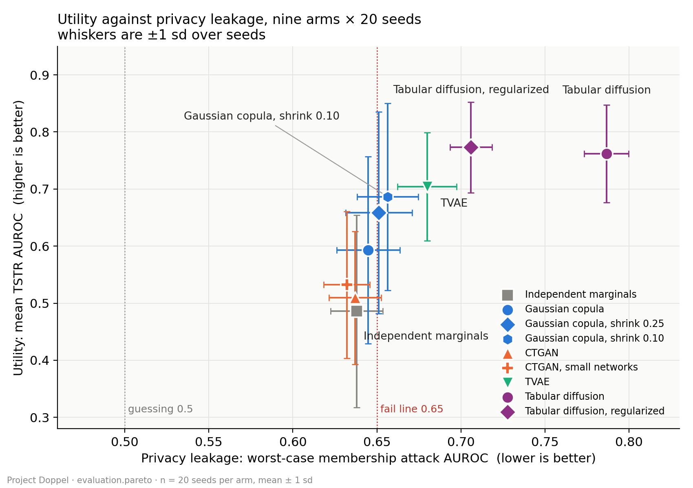

# Evaluation

*Track 2's section of the Phase 4 report. Written from [`report_evaluation_section_blueprint.md`](report_evaluation_section_blueprint.md); every number below is sourced there and, beyond it, in [`eval_protocol.md`](eval_protocol.md), [`full_evaluation_result.md`](full_evaluation_result.md), [`full_pareto_result.md`](full_pareto_result.md), [`positive_control_result.md`](positive_control_result.md) and [`membership_inference_survey.md`](membership_inference_survey.md). Status note at the end covers what this section does not yet include.*

## Why one protocol

A benchmark is only as good as the guarantee that every generator was scored the same way. This section describes that guarantee: one dataset, one fidelity definition, one utility task, one privacy attack suite, applied without modification to every generator Track 1 produced. The three axes — fidelity, utility, privacy — are described in turn below, followed by the headline benchmark and the trade-off it produces. Track 1's Results section interprets what these numbers mean for the generators; this section establishes that the numbers can be trusted to mean the same thing across them.

## Fidelity

Fidelity is scored per column against the real **training** split — the 94 rows a generator actually saw, not the holdout, which is reserved for utility and privacy. Categorical and binary columns are compared by Jensen–Shannon divergence directly; continuous columns are binned into ten quantile-based bins first and compared the same way. A separate correlation-preservation score takes the mean absolute difference between the real and synthetic Pearson correlation matrices, and a per-column Kolmogorov–Smirnov test reports what fraction of numeric columns pass at p ≥ 0.05. Binary columns are deliberately not quantile-binned: doing so collapses a two-valued column into a single bin and reports a JS divergence of zero regardless of the real positive rate, an error caught and fixed early in the project (P-007).

None of these three has a pass/fail threshold, and that is a decision rather than an omission. The protocol originally set one (correlation ≤ 0.10 good, ≤ 0.20 acceptable), but real train compared against real holdout — two samples of the same population, no generator involved — already scores a correlation difference of **0.203**, worse than the proposed failing threshold. No generator could pass against a bar the real data itself misses on a 94-row sample. The same reasoning dropped a utility threshold, described below. Fidelity and correlation are reported as numbers to compare across generators, not numbers to clear.

## Utility

Utility is scored train-on-synthetic, test-on-real (TSTR): a classifier trained on a generator's synthetic data is evaluated on the real, 35-row holdout, and compared against the same classifier trained on real data (train-on-real, test-on-real, TRTR) as a ceiling. The target is in-hospital mortality (`hospital_expire_flag`), chosen over 30-day readmission because the holdout has only 2 readmission positives against 6 for mortality — not enough to measure anything. Two classifiers are used, logistic regression and random forest, scored by AUROC because of the roughly 31/69 class split. The real-data ceiling from these same runs is **0.578** AUROC for logistic regression and **0.737** for random forest.

The original protocol considered a generator's utility acceptable if its TSTR AUROC came within 0.10 of the TRTR ceiling. That threshold was dropped for the same reason as the correlation one: on this holdout, seed-to-seed standard deviation of TSTR AUROC runs **0.15 to 0.22**, wider than the threshold itself, so whether a generator "passed" would be decided by which of the 20 seeds happened to run. Every utility number in this report is a mean over 20 seeds (42–61); none is quoted from a single run.

## Privacy: the attack suite

Privacy is measured by membership inference: whether an attacker, given a record and the synthetic data, can tell if that record was in the generator's training set. The attack is a shadow-model classifier — eight shadow generators fit on resampled subsets of the population, a nearest-neighbour distance computed for each as the signal, and a logistic-regression attacker trained to read membership from that distance. It is run three ways, over three feature sets: four numeric columns (`numeric4`), all 53 features by Gower distance (`gower`), and Jaccard similarity over ICD-9 code sets (`icd9_codes`). The reported privacy score for a generator is the **worst** of the three, not an average, because the weakest attack is uninformative on its own: the four-column attack reads **0.503–0.518** AUROC for every generator in the study, including one later shown to memorize half its training data. A report built on that attack alone would call every generator safe.

Two reference points calibrate every attack number. A generator that returns its own training rows unchanged — an exact copy — scores **1.000** on every attack, the ceiling. Real holdout rows the generator never saw score **0.489–0.503**, the floor an attacker achieves by guessing. Every reported attack number in this study falls between those two anchors, which is the check that the attack suite is measuring something rather than producing noise.

The attack design follows the shadow-model literature (Shokri et al.) under a deliberately strong threat model — the attacker knows the generator family and trains shadow generators of the same class — which [`membership_inference_survey.md`](membership_inference_survey.md) cross-checked against 18 sources, including the two EHR-specific benchmarks closest to this project's setting (Yan et al., Chen et al.). Three gaps the survey found against current practice are closed here: true-positive rate reported at low false-positive rate rather than AUROC alone, a per-record exposure report rather than only an aggregate, and a coverage check (`evaluation/synthetic_coverage.py`) that functions as an informal density-based signal. Two gaps remain open: a proper density-based attack, and a release-only attacker that does not require shadow-model access.

## Privacy: does the suite catch a generator that actually leaks?

A privacy score means nothing until it is shown to detect a generator known, independently, to leak. TVAE is that positive control: Track 1's own in-train memorization check found it reproduces 52–71% of its rows as near-exact copies. The attack suite catches it on two of its three attacks. Worst-case membership AUROC for TVAE is **0.680**, against **0.637–0.651** for the other four generators — a gap significant on every pairwise comparison (Welch's t-test, p < 0.0001, 20 seeds each) — and its pooled true-positive rate at 1% false-positive rate is **0.058**, roughly six times the attack's own chance rate of 0.010. The four-column attack, by contrast, rates TVAE at **0.503**, the lowest score of any of the five generators — the clearest demonstration in the study of why a weak attack reads as privacy.

The mechanism behind the gap is visible in the data, not just the metric: TVAE's synthetic output sits nearest to only **31 of the 94** training rows, against 40–47 for the other four generators, meaning its samples collapse onto a minority of the training set, with up to 24 synthetic rows crowding around a single training row where the other generators spread across 8–14.

A separate leakage channel appears in every generator, independent of architecture. Diagnosis codes seen only once in the training data leak through all five arms — AUROC **0.821–0.839** against a floor of 0.481 — including CTGAN, which the fidelity results below show has learned essentially nothing else. The mechanism is structural rather than model-specific: a generator can only emit a code it saw during training, so a code appearing in exactly one training admission uniquely identifies that admission whenever it shows up in synthetic output. Tellingly, TVAE's own leakage does *not* run through this channel — its per-record exposure correlates at −0.011 with how many once-seen codes a record holds, against 0.20–0.28 for the other four generators — confirming that its leakage and the rare-code channel are two distinct mechanisms, both real.

## Attribute inference

A second privacy test asks whether an attacker, given the rest of a synthetic record's columns, can predict a withheld attribute better for training patients than for unseen ones. The gap between those two accuracies — the **member gap** — is the privacy-relevant number, read against `independent_marginals`, which has no column dependence for an attacker to exploit and so defines the no-signal baseline. Three targets are scored (gender, first care unit, age bucket); a fourth, ethnicity, was dropped after one patient was found to hold 15 of the 35 holdout admissions in a single ethnicity category absent from training entirely, which made the attacker's task trivial and uninformative (P-003). TVAE's gender member gap is **0.183 ± 0.126** (p = 0.0004 against the no-dependence floor), about four times the floor's own 0.042 — the positive control appearing a second time, on an independent attack.

## The benchmark

*Figure 1 — mean TSTR AUROC against worst-case membership AUROC, five arms × 20 seeds. Produced by [`evaluation/plot_pareto.py`](../evaluation/plot_pareto.py) directly from `evaluation.pareto`'s loader, so the figure and the written numbers below come from the same computation.*

Five generator configurations were run through the full protocol above, each over 20 seeds, 100 runs in total, in one environment (Python 3.11.9, numpy 2.4.6, torch 2.14.0+cpu, ctgan 0.12.1). The full table is in [`full_evaluation_result.md`](full_evaluation_result.md); the headline, stated plainly: on 94 training rows, the statistical baseline matches or beats both neural generators on fidelity and privacy; TVAE matches the real-data utility ceiling only because it copies training rows; CTGAN produces data no more useful and no more private than a generator with no column dependence at all; and no generator wins on all three axes at once. Mean JS divergence against real train is **0.0162–0.0165** for the no-dependence floor and both copula configurations, against **0.0937** (CTGAN) and **0.1063** (TVAE) — the neural generators are roughly six times further from the real marginal distributions. Mean TSTR AUROC (random forest) ranges from **0.480** (the floor) to **0.738** (TVAE), and worst-case membership AUROC from **0.637** (CTGAN) to **0.680** (TVAE).

`evaluation/pareto.py` reduces each generator to its position on fidelity, utility and worst-case privacy, and marks which configurations no other configuration beats on every axis at once (full evidence in [`full_pareto_result.md`](full_pareto_result.md)). On this five-arm set, all five are non-dominated — bootstrap frontier frequency 0.81 to 0.97 over 2,000 resamples, with no pairwise dominance probability above 0.16 — so the frontier describes the shape of the trade-off rather than ranking the generators. The frontier was validated under eight different choices of which axes to use, including dropping utility entirely: without it, TVAE's frontier frequency falls from 0.86 to **0.00**, since every other generator beats it on both remaining axes. TVAE holds a place on the frontier through utility alone, and Figure 1 and the benchmark above show that utility is copied signal rather than learned structure.

## Status: what this section does not yet include

The benchmark above is Track 2's own, run and reproduced on this machine, and is the verified result this report currently stands on. Since it was produced, Track 1's Phase 3 tuning (ADR-029) added four configurations to the evaluation harness — a tuned copula, a tuned CTGAN, and two tabular-diffusion configurations — and ran this section's unchanged protocol over them to produce a 9-arm, 180-run table, written up in [`final_comparison_result.md`](final_comparison_result.md). That document is explicit that the result is evidence for Track 2 to fold in, not a replacement for this section, and its headline findings (diffusion leaking as high as 0.787, both diffusion configurations exceeding the real-data utility ceiling while generating a badly wrong mortality rate) are not reported here as independently verified.

The plan is to rerun `evaluation.eval_runner` over those four arms in this environment, fold the result into `full_evaluation_result.md`, `full_pareto_result.md` and this section, and regenerate Figure 1 against all nine arms before the report is finalized. That rerun is deliberately sequenced after everything else in this section, so the narrative and the figure are not produced twice.
